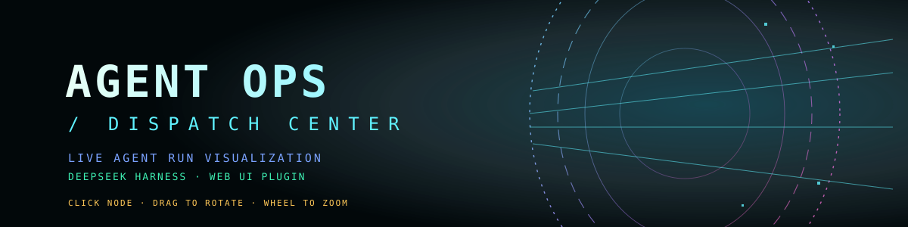

<div align="center">



# Agent Ops / Dispatch Center

**把 AI Agent 的运行过程，实时投射成一座科幻「调度中心」仪表盘。**
*A live, interactive agent-run visualization plugin for DeepSeek Harness (DSH Web UI).*

`DSH 插件` · `Canvas 2D + React` · `零运行时依赖` · `全部本地运行`

</div>

> 灵感来源：[抖音 @Robot汪的日常](https://www.douyin.com/) 的「AI Agent 运行可视化」视频。
> 这是一个独立实现：一个真正挂在 DSH 界面里的插件，而不是一段录屏或静态页面。

---

## 这是什么

Agent Ops 是一个 **DeepSeek Harness 的 Web UI 插件**。它把当前会话里 Agent 真实发生的事情——工具调用、Token 流、子代理、文件读写、事件日志——投射成一整屏的交互式「调度中心」：

- 中间是一团**可交互的记忆云**：每次工具调用 / 文件触碰 / 模型回复 / 思考都会变成一颗彩色节点，自动缓慢旋转；悬停出标签，点击钉住并在右侧查看详情，拖动旋转，滚轮缩放。
- 外圈是一圈绕圆心持续旋转的**卡片光冕**：每张卡片就是一个「粒子喷嘴」——粒子从卡片左端中点进入、穿过卡片、从右端中点冒出并 ±20° 扇开射远。
- **选中记忆云里的节点**，与它关联的卡片会自动转到明显可见的位置、亮起来，整个环边转边平滑减速；取消选中后恢复旋转。
- 左右与底部是完整 HUD：GLOBAL STATUS、AGENT ROSTER、DISPATCH BUFFER、AGENT REGISTRATION、MEMORY INSPECTOR，以及 TASK FEED / WORKER PROFILE / TOOL CHANNEL / TELEMETRY 四条信息流。
- 顶栏的 `LIVE FEED` / `SIMULATION` 徽标会告诉你：现在看的是**真实会话数据**，还是 HUD 自带的仿真演示（会话空闲或数据接口不可达时自动切换，保证画面永远在动）。

## 环境要求

- 一个带插件系统的 DeepSeek Harness（DSH Desktop 或 DSH Web），版本需提供：
  - `shell.overlay` 插槽（用于全屏 HUD 覆盖层）
  - 客户端插件模块加载（`dsh.client`）
  - Host 端 `webServer` + `sessions` 服务与 `session/event` 事件（用于读取实时会话数据）
- 仓库已经包含构建好的 `client.js`，**安装不需要 Node.js 或任何构建步骤**。
- 只有修改源码（`src/*.js`）时需要 Node.js 22+ 重新 `node build.mjs`。

## 安装

### 方式 A（推荐）：让 DSH 里的 Agent 帮你安装本地 bundle

1. 把仓库克隆或下载解压到本机任意目录，例如：
   ```powershell
   git clone https://github.com/xinranmn-wq/dsh-agent-ops.git
   ```
2. 在 DSH 的对话里直接说（把路径换成你本机的绝对路径）：
   > 帮我把 `C:\path\to\dsh-agent-ops` 这个目录作为本地插件 bundle 安装到当前 profile。
   DSH 里的 Agent 会调用插件管理能力（`plugin_manager` → `install_bundle`）完成安装，并把插件写进当前 profile。
3. 安装完成后**强制刷新**页面（`Ctrl+Shift+R`）。右下角会出现一颗发光圆环，点它打开仪表盘；每次页面加载也会自动打开一次。

### 方式 B：如果本机 DSH 提供命令行

```powershell
dsh plugin --profile <你的 profile 名> add link:C:\path\to\dsh-agent-ops
```

### 方式 C：图形界面

打开 DSH 的 **设置 → 插件**，按当前版本的入口添加本地插件目录 / 启用 `Agent Ops 调度中心`，然后强刷页面。

> 安装后可在 **设置 → 插件** 里确认条目「Agent Ops 调度中心 / Agent Ops Dispatch Center」已启用；
> 插件的显示名、描述与图标来自 `locale/{zh,en}.json` 和 `icon.svg`。

## 使用

| 操作 | 效果 |
| --- | --- |
| 点击右下角发光圆环 | 打开 / 关闭仪表盘 |
| `ESC` 或右上角 `×` | 关闭仪表盘 |
| 悬停记忆云节点 | 显示节点标签，右侧 `MEMORY INSPECTOR` 同步 |
| 点击记忆云节点 | 钉住该记忆；关联卡片自动转到可见位置并亮起；整环平滑减速 |
| 拖动记忆云 | 旋转记忆云（松开后带惯性） |
| 滚轮（指针在场景上） | 缩放记忆云 |
| 点击卡片 | 该卡片进入聚焦 / 阅读态，整环减速 |
| 点击空白处 | 取消选中，恢复旋转 |
| 点击 TASK FEED / DISPATCH BUFFER 行 | 选中对应记忆（与场景双向联动） |

`LIVE FEED` = 正在显示当前 DSH 会话的真实事件流；`SIMULATION` = 会话空闲或数据不可达时，HUD 自动播放的仿真演示（数据是假的，但交互与动画完全一样）。

## 数据与隐私

- Host 半只做一件事：监听本机 DSH 的 `session/event` 追加事件，折叠成一份紧凑快照，通过**同源、只读**的 `GET /dsh-agent-ops/state` 暴露给页面。
- 浏览器半每 1100 ms 轮询一次这个本地路由；**不向任何外部服务器发送数据**，没有遥测、没有第三方请求、没有外部字体/图片资源（全部 Canvas/SVG/系统字体绘制）。
- 快照只包含会话运行所需的元数据：会话/代理状态、工具名与目标、事件日志、Token 计数等，不读取、不上传你的文件内容。

## 工作原理

```
DSH Host                                         DSH Web 页面
┌──────────────────────────┐                    ┌──────────────────────────────┐
│ session/event 事件流       │  GET /dsh-agent-   │ HUD（React）                   │
│   ↓ 折叠成 snapshot       │  ops/state  ←1100ms│  ├─ 轮询快照 / 空闲转仿真        │
│ webServer 只读路由         │ ──────────────────▶ │  ├─ 构建场景模型                 │
└──────────────────────────┘                    │  └─ shell.overlay 全屏挂载      │
                                                │ Scene（Canvas 2D）              │
                                                │  ├─ 卡片光冕 / 旋转 / 粒子射线    │
                                                │  ├─ 记忆云（伪 3D，可交互）       │
                                                │  └─ 网络图 / CRT 后期 / 相机漂移  │
                                                └──────────────────────────────┘
```

| 文件 | 作用 |
| --- | --- |
| `index.js` | Host 半：监听会话事件、维护快照、注册 `/dsh-agent-ops/state` |
| `client.js` | 浏览器半的**构建产物**（由 `build.mjs` 从 `src/*` 拼装，请勿手改） |
| `src/scene.js` | Canvas 场景：卡片光冕、记忆云、射线粒子、网络图、CRT 后期 |
| `src/hud.js` | React HUD：面板、轮询、仿真、交互联动、启动圆环 |
| `src/entry.js` | 注册到 `shell.overlay` 插槽 |
| `cordis.patch.yml` | 插件包 patch：向 profile 插入 `dsh-agent-ops` 插件行 |
| `locale/*.json` / `icon.svg` | 插件管理器的显示元数据与图标 |
| `test-host.mjs` / `test-client.mjs` | 无需 DSH 的本地验证：Host 半假上下文试跑、浏览器半加载/渲染/交互冒烟测试 |

## 开发

```powershell
node build.mjs        # src/scene.js + src/hud.js + src/entry.js -> client.js
node --check client.js
node test-host.mjs    # Host 半冒烟测试（假 Cordis 上下文 + 假 HTTP）
node test-client.mjs  # 加载 bundle、渲染 HUD 树、跑场景帧与指针交互
```

修改浏览器半后：

1. `node build.mjs` 重新生成 `client.js`；
2. 在 DSH 页面 **Ctrl+Shift+R** 强制刷新（客户端模块会被浏览器缓存，普通刷新可能仍是旧版本）；
3. 修改 Host 半（`index.js`）后，需**重启 DSH** 才会重新加载该模块。

欢迎 PR：更漂亮的光冕、更细腻的粒子、更多交互、或者适配新版本 DSH 的 API 变更都可以。

## 自定义

想调手感，主要旋钮都在 `src/scene.js` 顶部/附近：

| 常量 | 含义 | 当前值 |
| --- | --- | --- |
| `CARD_N` | 光冕卡片数（环上的槽位数） | `42` |
| `CARD_F` | 卡片环的径向半径系数 | `0.79` |
| `ringSpeed` / idle 基础转速 | 环的角速度（rad/s） | `≈0.27` |
| `FAN_SPREAD` | 卡片出口粒子扇开的半角 | `≈19.5°` |
| `LINK_TARGET_ANGLE` | 选中记忆后卡片停靠的可见位置 | `RING_NEAR + 0.12` |
| `memC.r` | 记忆云半径系数 | `0.152 · min(W,H)` |

配色集中在 `src/scene.js` 的 `PALETTE` 表与 `src/hud.js` 的 CSS 变量里；整体配色是「多色荧光控制台」，可按喜好替换成任意主题。

## 已知限制

- 这依赖 DSH 的内部插件 API（插槽、客户端模块、Host 服务），DSH 大版本升级后可能需要适配。
- `client.js` 是构建产物：修完源码请记得重新 `build` 并把产物一起提交。
- 页面里的 `simulation` 模式下展示的是内置演示数据，不要当成真实运行记录。
- 性能：1920×1080 下目标 60fps；如果设备较弱，可降低 `CARD_N` 或减少粒子池大小。

## 卸载

- **设置 → 插件** 里禁用或移除「Agent Ops 调度中心」；
- 或让 DSH Agent 执行 `plugin_manager` 的 `remove_bundle`（包名 `@local/dsh-agent-ops`）；
- 卸载后强刷页面即可。

## License

[MIT](LICENSE)

---

## English

**Agent Ops / Dispatch Center** is a DeepSeek Harness (DSH) Web UI plugin that visualizes a live
agent run as an interactive sci-fi mission-control hologram:

- a slowly revolving **corona of status cards**, each acting as a particle nozzle
  (particles enter at the card's left midpoint, cross it, exit at the right midpoint and fan out);
- an interactive pseudo-3D **memory cloud** (hover / click / drag / wheel) built from the session's
  tool calls, files, model replies and thoughts;
- selecting a memory **rotates its linked card into view, lights it up, and eases the ring down**;
- full HUD rails and event feeds fed by the real session event stream through a local, read-only
  `GET /dsh-agent-ops/state` route (with a built-in simulation fallback when the session is idle).

**Install**: clone/download this repo, then ask the DSH agent to install the local bundle
(`plugin_manager` → `install_bundle` with this directory), refresh the page with `Ctrl+Shift+R`,
and click the glowing ring at the bottom-right. No Node.js or build step needed to install.

**Privacy**: everything runs locally; the plugin only reads the current DSH session's event metadata
and never sends data anywhere.

MIT licensed — PRs welcome.
